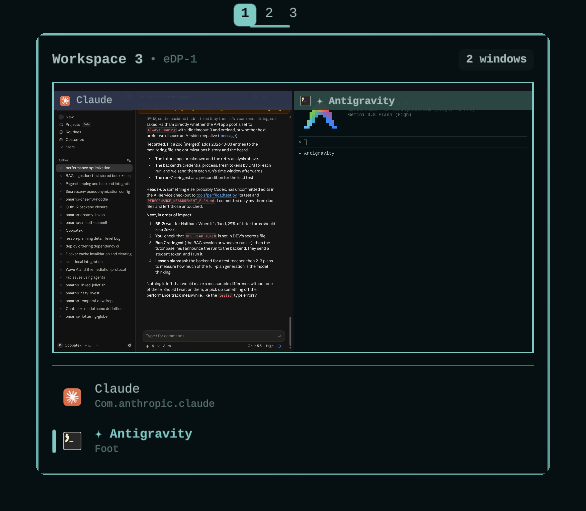

# Hoverview for Omarchy

An [Omarchy](https://omarchy.org) 4.5 bar widget that replaces the
workspace numbers. Hover a number to get a live, to-scale picture of that
workspace without switching to it.

<p align="center"></p>

## What it does

- **Per-monitor workspaces.** Follows Omarchy 4.5's per-monitor workspaces:
  each monitor's bar shows its own 1–10 (Hyprland numbers them in blocks of
  ten per monitor: 1–10, 11–20, …), plus workspaces visiting from an
  unplugged monitor after a gap. Shows the occupied ones plus the shown one,
  and optionally 1 to N always. The shown workspace gets an accent pill,
  solid on the screen that has focus and faded on the others, so you can
  see which screen Super + number will act on.
- **Layout shapes.** The active workspace's number sits on its layout
  shape: a square (tiling), circle (scrolling) or triangle (floating).
  Optionally every workspace's number sits on a faint shape of its own.
  Click the active one to cycle the layout like Super + L; the hover card
  names the layout.
- **Scroll to switch.** The mouse wheel or touchpad scrolls through
  workspaces without wrapping.
- **Live hover preview.** Each window is drawn where it really sits on the
  monitor, with a live capture of its contents, its icon and its title.
  Turn captures off and it draws icons and names instead.
- **Tab-aware.** For a Hyprland window group (tabs), the preview shows the
  tab that is actually on screen, not a random member of the group.
- **Window list.** The workspace's windows are listed under the preview, up
  to a limit you can set. Click a tile or a row to jump straight to that
  window.
- **Full-screen peek.** Rest the pointer on the mini screen to briefly switch
  to that workspace (when it's on the monitor you're using). Move away and
  you're back where you were; click to stay.
- **Multi-monitor.** On a secondary monitor's bar the shown workspace is
  marked in your theme's magenta, or a color you pick, instead of the
  accent, so you can tell screens apart at a glance.

Each of these can be tuned or turned off. See [Settings](#settings).

## Install

```bash
omarchy plugin add https://github.com/AbdulrahmanHR/omarchy-hoverview --enable
```

Omarchy asks before cloning, then asks where on the bar the widget goes (the
center by default). Plugins run as unsandboxed code inside the Omarchy shell,
so read the code before you enable it.

The widget replaces Omarchy's workspace numbers. While those are still on
the bar, right-click any Hoverview number and press **Replace them** at the
top of the settings panel: Hoverview takes their place and they come off
the bar. To do it by hand, remove the `omarchy.workspaces` entry from
`bar.layout` in `~/.config/omarchy/shell.json` (the shell reloads it on save).

### Updating

```bash
omarchy plugin update io.github.abdulrahmanhr.hoverview
omarchy restart shell
```

The shell reloads a changed plugin on its own, but it can keep pieces of the
old version in memory, and then the widget fails to load or runs old code.
Restarting the shell after an update clears that.

If you added the plugin without enabling it:

```bash
omarchy plugin enable io.github.abdulrahmanhr.hoverview
```

## Settings

### Settings panel

Right-click any workspace number to open the settings panel. It writes to
the same `shell.json` entry described below, so changes apply right away
and show up in the file and the CLI too.

If you put the settings button somewhere else, another bar widget can embed
`SettingsPanel.qml`: load it, set its `bar` and `anchorItem` properties, and
call `open()`, `close()` or `toggle()` (it also exposes `opened`).

### shell.json and the CLI

Settings are extra keys on the widget's entry in `bar.layout` of
`~/.config/omarchy/shell.json`. The shell reloads the file on save and the
widget applies the change right away. No restart needed.

You can also set them from the command line. Add `--json` for numbers and
booleans so they're stored as real values, not strings:

```bash
omarchy bar set io.github.abdulrahmanhr.hoverview previewWidth 520 --json
omarchy bar set io.github.abdulrahmanhr.hoverview peekOnHover false --json
omarchy bar set io.github.abdulrahmanhr.hoverview secondaryMonitorColor '#89b4fa'
```

The entry in `shell.json` then looks like this:

```json
{
  "id": "io.github.abdulrahmanhr.hoverview",
  "previewWidth": 520,
  "peekOnHover": false,
  "secondaryMonitorColor": "#89b4fa"
}
```

Every setting is optional. Missing keys use the defaults below. Numbers
outside the range are clamped, and invalid values fall back to the default.

| Setting | Default | What it does |
|---|---|---|
| `persistentWorkspaces` | `0` | Always show this monitor's workspaces 1 to N, even when empty. `0` shows only workspaces with windows plus the one you're on. Whole number, 0–10. |
| `labelVerticalOffset` | `0` | Nudges the workspace labels up (negative) or down (positive) for fonts that sit off-center. -10 to 10, in steps of 0.5. |
| `showLayoutShape` | `true` | Draw the active workspace's number on its layout shape (square tiling, circle scrolling, triangle floating) instead of the plain accent pill. |
| `alwaysShowLayoutShapes` | `false` | Draw every workspace's number on a faint layout shape, not only the active one. |
| `cycleLayoutOnClick` | `true` | Click the already-active workspace to cycle its layout (tiling, scrolling, floating), like Super + L. |
| `colorSecondaryMonitor` | `true` | Mark the shown workspace on a secondary monitor's bar (Hyprland monitor id above 0) in the color below instead of the accent. |
| `secondaryMonitorColor` | `""` | Hex color for that tint, `#RRGGBB` or `#AARRGGBB`. Empty uses your theme's magenta (then purple, orange, yellow). |
| `preview` | `true` | Show the hover card. Off turns the widget into plain workspace numbers. |
| `hoverDelayMs` | `220` | How long to hover before the card opens. Milliseconds, 0–2000. |
| `previewWidth` | `420` | Width of the preview, before UI scaling. Pixels, 240–800. |
| `livePreview` | `true` | Live captures of window contents. Off draws app icons and names instead, which is lighter on the GPU. |
| `showWindowList` | `true` | Show the list of windows under the preview. |
| `maxListedWindows` | `6` | How many windows the list shows before "+ N more windows". 1–20. |
| `highlightLastFocused` | `true` | Highlight the window you used last on the hovered workspace. Off highlights only the window that has focus right now. |
| `peekOnHover` | `true` | Rest the pointer on the preview to briefly switch to that workspace. |
| `peekDelayMs` | `180` | How long to rest on the preview before peeking. Milliseconds, 0–2000. |

## Requirements

- Omarchy 4.5 or newer (per-monitor workspaces,
  `omarchy-hyprland-workspace-layout-current` / `-toggle`)
- Hyprland 0.56 or newer (uses the Lua dispatcher syntax and the `visible`
  field of `hyprctl clients` to find the shown tab of a group)

There are no other dependencies. The widget reads window data with
`hyprctl -j clients` when you hover, and reads theme colors from
`~/.local/state/omarchy/current/theme/colors.toml`. It also reads
`~/.local/state/omarchy/monitor-workspaces` (monitor to block) and runs
`omarchy-hyprland-workspace-layout-current` for each shown workspace. The only configuration
it changes is its own `shell.json` entry, through `omarchy bar set`, when you
use the settings panel.

## Remove

```bash
omarchy plugin remove io.github.abdulrahmanhr.hoverview
```

Then put Omarchy's own workspace numbers back on the bar if you want them:

```bash
omarchy bar put omarchy.workspaces --section center
```

## License

[MIT](LICENSE)
